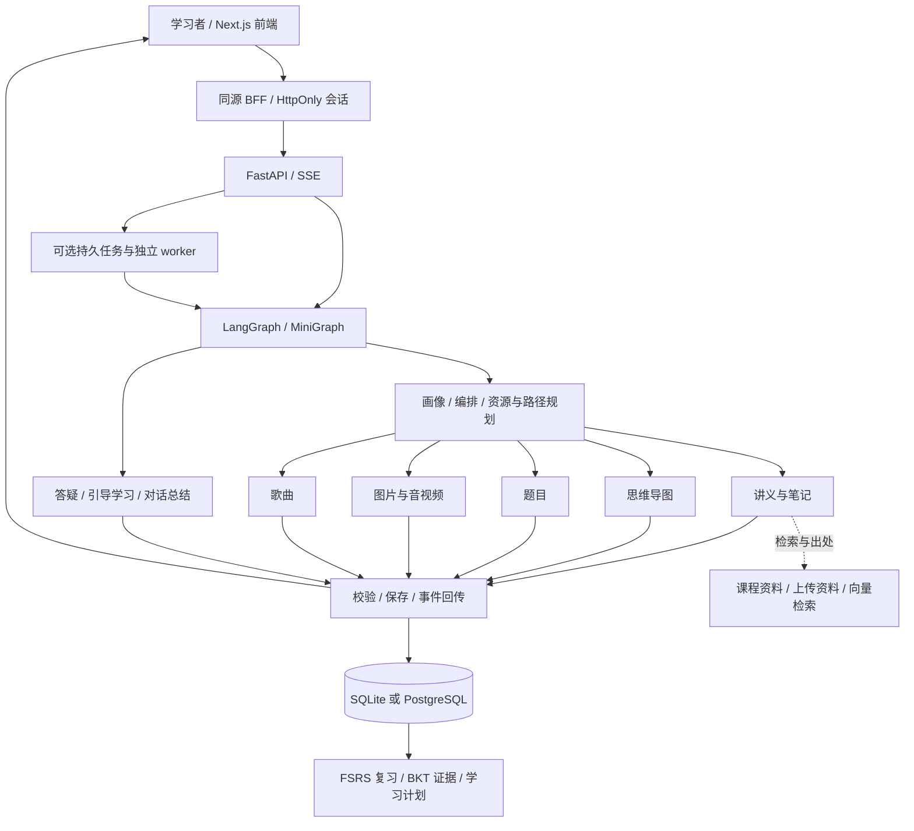

# 知行循证 LearnLoop · AI 个性化学习平台

LearnLoop 面向有明确学习任务的个人学习者，把资料阅读、AI 答疑、练习反馈和间隔复习放在同一个学习空间中。学习者可以选择内置课程，也可以围绕自己的主题与资料开始学习。

项目早期名称为 **SparkLearn 星火学伴**。GitHub 仓库、包名、部分数据库表及部署脚本继续保留 `sparklearn` 命名，它们属于同一项目。

- **代码仓库**：[vv510-ai/sparklearn-multiagent](https://github.com/vv510-ai/sparklearn-multiagent)
- **网站入口**：[知行循证 LearnLoop](https://47.121.24.54/)
- **阅读顺序**：[快速开始](#快速开始) → [功能与适用范围](#功能与适用范围) → [模型与环境配置](#模型与环境配置) → [测试与验收](#测试与验收)

本 README 根据当前仓库的实现、依赖和配置整理。功能存在、接口返回成功、Mock 测试通过和真实学习效果是不同的结论；历史测试报告只代表对应日期、版本与环境。

## 功能与适用范围

| 功能 | 当前实现 | 使用条件与边界 |
| --- | --- | --- |
| 多课程学习空间 | 课程、资料、对话、资源、作答与学习计划按账号和 notebook 隔离；支持数据结构、Python 入门、高数入门、大学英语六级及自定义主题 | 内置内容覆盖范围各不相同；自定义课程的题目与难度未经标准化测评标定 |
| 资料学习与答疑 | 支持 Markdown、TXT、PDF、DOCX、PNG、JPG/JPEG 资料；检索相关片段，展示来源，提供分步骤讲解和后续追问 | 扫描件依赖 OCR；资料课程会按页面展示的范围取样，不能把取样检查称为全文测评 |
| 学习工坊 | 讲义、结构化笔记、思维导图、题组、代码练习、闪卡、一图看懂、PPT、音视频、记忆歌曲等资源入口 | 不同产物依赖不同供应商、密钥、运行工具和服务额度；详见下表 |
| 起点检查与学习计划 | 根据目标、可用时间、题目表现与课程先修关系安排学习；保留首次作答、提示与复测记录 | 自述偏好不等于能力证据；BKT 掌握度是模型估计，不是正式成绩 |
| 复习与回忆练习 | 词汇、错题、阅读训练、闪卡和歌曲口诀共用 FSRS-6 调度；提前练习保留原到期安排，提示与错误影响后续安排 | 使用 `fsrs==6.3.2` 默认参数，未宣称训练了个人记忆模型；旧记录按兼容规则进入新调度 |
| 六级备考 | 备考建议、每日背词、词义/拼写回忆、英美静态发音、阅读点词和原句收藏、来源试卷阅读、分板块练习与写作/翻译反馈 | 题源入口与完整题面托管有区别；听力、扫描卷和不同年份的可练范围并不一致；AI 反馈不提供官方分数 |
| 生成进度与恢复 | SSE 事件展示生成阶段；可启用持久生成任务、事件回放、断线恢复和外部任务续查 | 默认开发配置未开启持久队列；生产配置启用独立 worker；未确认是否受理的付费任务需要核对 |
| 教学研究工具 | 独立 `/teacher` 入口支持研究方案、匿名观测与描述统计 | 不是完整的班级/作业管理系统，也不代表已完成真实教学效果研究 |

六级词表、原始来源和学习记录保持各自标识；词表外的阅读词条不会自动算入六级词表覆盖率。资料引用与模型复核可以帮助发现问题，但不能保证每句话、公式、图片或答案都正确。

范围与交互细节见 [学习空间](docs/learning-spaces.md)、[六级课程](docs/cet6-course.md)、[六级学习流程](docs/2026-10-04-cet6-student-redesign.md)、[真题词句与复习连接](docs/2026-10-05-reading-review-loop.md)、[统一复习与问答记录](docs/quality/2026-10-17-chat-review.md)。

### AI 与多模态能力

| 能力 | 代码中的接入方式 | 需要准备什么 |
| --- | --- | --- |
| 文本生成、答疑、题目复核 | 统一 `llm_complete()` / `llm_stream()` 网关，支持 OpenAI、DeepSeek、Kimi、讯飞星火；无文本密钥可使用 MockEngine | 对应服务端 API 密钥，以及该账号实际可用的模型名称 |
| OCR / 图片理解 | OpenAI 或讯飞视觉服务；RapidOCR + ONNX Runtime 提供本地 OCR 路径 | 云端视觉密钥，或已安装的本地 OCR 依赖；本地 OCR 不等于完整视觉推理 |
| 一图看懂 / 图片 | OpenAI、讯飞、小云雀；生成前整理内容，生成后尝试核对图片内容 | `IMAGE_PROVIDER` 与对应密钥；检查未通过或不可用时仍需人工核对 |
| 语音提问 / 朗读 | OpenAI 或讯飞 ASR；OpenAI、ElevenLabs 或讯飞 TTS | 对应能力的密钥、音色权限和浏览器麦克风权限；词表静态发音不依赖实时 TTS |
| 讲解视频 | 火山 Ark / 小云雀异步任务、本站转存；另有固定 Manim 素材与本机视频工具 | 对应视频服务权限与额度；短概念片段、分镜讲稿和完整长视频须分别确认 |
| PPT | 文本模型生成并校验提纲后，用 `python-pptx` 输出可编辑页面；也保留讯飞 PPT 接入 | 原生方案需要可用文本模型；讯飞方案需要单独服务授权 |
| 记忆歌曲 | 歌词、口诀与练习；演唱由 Suno 第三方接入完成 | `SUNO_API_KEY` 等配置；未配置时只能生成口诀与歌词，不会生成真实演唱 |
| 本人订阅 / 浏览器接入 | 可选的本机 Kimi/ChatGPT 文字接入、个人 Chat 图片 worker、Claude 视频工具 | 本人重新登录、配对及本机工具运行；个人接入不等于云端服务已接通，也不向其他客户共享个人订阅 |

配置中的默认模型名称只是项目默认值，不是对供应商当前可用性、账户额度或生成质量的保证。个人图片接入默认关闭，绑定指定账号，详见 [个人 Chat 图片接入](docs/2026-10-15-personal-chat-image.md)。

## 技术架构



| 层次 | 主要技术与仓库版本依据 |
| --- | --- |
| 后端 | Python；Docker 使用 `python:3.11-slim`，Windows 原生启动器采用 Python 3.12 路线；FastAPI、Pydantic、SQLAlchemy |
| 编排 | LangGraph，缺失时使用内置 MiniGraph；请求级事件与并行状态合并 |
| 前端 | Next.js `16.2.12`、React `19.2.8`、TypeScript `5.5.3`、Tailwind CSS `3.4.6` |
| Node.js | 前端 Docker 固定 `node:24.18.1-alpine`；原生启动器要求 Node.js `22.19` 或更高版本 |
| 数据与任务 | 本地 SQLite；容器 PostgreSQL 16、Redis 7；持久任务保存阶段、事件和外部调用状态 |
| 检索 | FastEmbed / ONNX 本地中文向量、可选 BGE-M3 / 讯飞向量、哈希降级；内存/JSON 存储及可选 Milvus |
| 复习与资源 | `fsrs==6.3.2`、`python-pptx==1.0.2`、PDF.js、KaTeX、Markdown、图表渲染 |
| 验证 | pytest、Playwright `1.62.1`、前端生产构建与统一验收脚本 |

前端使用 [package-lock.json](frontend/package-lock.json) 锁定依赖。后端 [requirements.txt](backend/requirements.txt) 多数是版本范围，暂未提供完整的 Python 锁文件；不同时间重新安装可能获得不同的传递依赖。

## 快速开始

### 获取代码

```bash
git clone https://github.com/vv510-ai/sparklearn-multiagent.git
cd sparklearn-multiagent
```

本仓库为私有仓库，克隆需要拥有访问权限的 GitHub 账号。仓库包含课程数据与静态音频，首次克隆和构建可能耗时。先安装 Git；以下两种方式任选一种。

### 方式一：Docker Compose 本地体验

需要 Docker 与 Docker Compose v2。在仓库根目录运行；如果已经存在 `.env`，保留原文件并按需核对配置，不覆盖已有密钥。

```powershell
# Windows PowerShell，首次配置时执行
Copy-Item .env.example .env
docker compose up -d --build
docker compose ps
```

macOS / Linux 首次复制使用 `cp .env.example .env`，其余 Compose 命令相同。

- 学习网站：<http://localhost:3000>
- 后端健康接口：<http://localhost:8000/api/health>
- 后端 API 文档：<http://localhost:8000/docs>

所有文本密钥留空时，默认 `DEMO_MODE=auto` 使用 MockEngine。示例配置显式设置了 `AUTH_REQUIRED=true`，因此首次使用仍需注册/登录；“Mock 文本”与“是否要求登录”是独立设置。

```bash
# 查看服务日志
docker compose logs --tail=100 backend frontend

# 停止本地服务；保留数据卷
docker compose down
```

默认 [docker-compose.yml](docker-compose.yml) 是本地开发栈：使用开发数据库口令，并暴露 5432、6379、8000、3000 端口。不要直接把该配置用于公网服务。它持久化数据库和生成文件，但未为上传目录及向量快照配置完整的持久卷；需要保留学习资料时使用生产配置或自行配置持久化与备份。

首轮 Docker 构建需要下载 Python/Node 依赖与本地向量模型，不能将“无 API 密钥演示”理解为“首次安装完全不用网络”。

### 方式二：Windows 源码开发

准备 Python 3.12、Node.js 22.19 或更高版本和 Git。以下在全新克隆目录运行，使用两个 PowerShell 终端；直接调用虚拟环境解释器，无需改变 PowerShell 执行策略。

**终端 1：后端**

```powershell
Copy-Item .env.example .env
py -3.12 -m venv backend\.venv
.\backend\.venv\Scripts\python.exe -m pip install -r backend\requirements.txt

# 当前终端强制使用演示文本，便于先检查页面与流程
$env:DEMO_MODE = "true"
# 本地初次体验用哈希向量，减少模型下载；语义检索效果较弱
$env:EMBEDDING_BACKEND = "hash"
Set-Location backend
.\.venv\Scripts\python.exe -m uvicorn app.main:app --reload --host 127.0.0.1 --port 8000
```

**终端 2：前端**（从仓库根目录开始）

```powershell
Set-Location frontend
npm ci
$env:BACKEND_URL = "http://localhost:8000"
npm run dev
```

打开 <http://localhost:3000>，注册账号，创建课程，再尝试提问或生成一份学习资源。完成基础启动后，在私有 `.env` 中填写所选模型密钥、将 `DEMO_MODE` 改为 `false` 或 `auto`，并关闭设置过 `DEMO_MODE=true` 的旧终端后重新启动后端。首次正式检索可将 `EMBEDDING_BACKEND` 改为 `auto`，允许下载/加载相应模型。

本地数据库默认是 `backend/sparklearn.db`。后端读取仓库根目录 `.env` 与 `backend/.env`；后者同名项覆盖前者，启动进程中的环境变量优先。前端从服务端变量 `BACKEND_URL` 读取后端地址，也兼容旧的 `NEXT_PUBLIC_BACKEND_URL`。前端不能放供应商密钥。

**macOS / Linux 等价启动**：用 `python3.11 -m venv backend/.venv`（或 Python 3.12）创建环境，使用 `backend/.venv/bin/python` 安装依赖；在 `backend` 目录运行 `DEMO_MODE=true EMBEDDING_BACKEND=hash .venv/bin/python -m uvicorn app.main:app --reload --port 8000`。另一终端在 `frontend` 运行 `npm ci` 和 `BACKEND_URL=http://localhost:8000 npm run dev`。

### 可选：Windows 本机启动菜单

需要本人订阅、图片或视频接入时，可使用仓库内的原生启动器；它会额外安装相关工具并询问本机拥有者信息。此路线和上面的两个终端开发路线二选一即可。

```powershell
# 在仓库根目录，首次安装
py -3.12 scripts\mac\native.py setup

# 后续启动、查看状态和停止
.\scripts\windows\run.cmd start
.\scripts\windows\run.cmd status
.\scripts\windows\run.cmd stop
```

该启动器使用本地前端 <http://localhost:18090>、后端端口 18010，并把状态写入忽略目录 `.native/`。本机学习数据与云端数据分开。仓库外分发包中的 `01-启动网站.cmd` 等快捷入口不是 Git 克隆的必要文件；Git 用户直接使用上面的仓库内命令。详细说明见 [Windows 运行说明](docs/Windows运行说明.md)。

## 模型与环境配置

配置入口为 [.env.example](.env.example) 和 [backend/app/config.py](backend/app/config.py)。只把真实值保存到本地或服务器私有 `.env`；README、示例配置、前端代码和提交记录中均不放密钥。

| 类别 | 关键变量 | 使用说明 |
| --- | --- | --- |
| 演示与文本路由 | `DEMO_MODE`、`LLM_PROVIDER` | `DEMO_MODE=true` 为 Mock；`false` 请求真实服务；`auto` 根据所选供应商及文本密钥判断。`LLM_PROVIDER=auto` 按 OpenAI → DeepSeek → Kimi → Spark 选择 |
| 文本供应商 | `OPENAI_API_KEY`、`DEEPSEEK_API_KEY`、`KIMI_API_KEY`、`SPARK_API_PASSWORD` | 至少配置所选供应商；对应 `*_BASE_URL`、`*_MODEL` 等控制端点与模型。讯飞文本 APIPassword 不等于 WebAPI 三元组 |
| 登录与加密 | `AUTH_REQUIRED`、`AUTH_SECRET`、`AUTH_TOKEN_MINUTES`、`MODEL_KEY_ENCRYPTION_SECRET` | 公网保持登录保护；生产配置足够长的随机登录密钥和独立模型密钥加密材料。后者虽未列入示例文件，当前代码已支持 |
| 前后端连接 | `BACKEND_URL`、`FRONTEND_ORIGIN` | 本地默认后端 8000、前端 3000；Docker 内前端使用 `http://backend:8000` |
| 数据库与存储 | `DATABASE_URL`、`REDIS_URL`、`OBJECT_STORAGE_*` | 本地可用 SQLite；生产采用 PostgreSQL 与持久卷。对象存储为可选路径，不能代替数据库备份 |
| 检索 | `EMBEDDING_BACKEND`、`MILVUS_URI`、`RERANK_MODE`、`RERANK_API_URL`、`RERANK_API_KEY` | `hash` 适合离线流程演示；`auto` 等真实向量路径可能需要模型下载或供应商服务 |
| 多模态路由 | `IMAGE_PROVIDER`、`VISION_PROVIDER`、`ASR_PROVIDER`、`TTS_PROVIDER`、`PPT_PROVIDER`、`VIDEO_PROVIDER` | 选择对应的已配置服务；各项可独立启停 |
| 多模态凭据 | `SPARK_*`、`XYQ_ACCESS_KEY`、`ARK_API_KEY`、`ELEVENLABS_API_KEY`、`ELEVENLABS_VOICE_ID` | 依能力配置；同一供应商的文字、语音、图片、PPT 不一定共享服务授权 |
| 开关与预算 | `MM_*_ENABLED`、`MM_*_TIMEOUT_S` 等 | 限制外部调用、等待与下载。关闭/失败后可能展示文字、固定素材或错误状态，不等于真实产物生成成功 |
| 持久任务 | `GENERATION_JOBS_ENABLED`、`GENERATION_WORKER_MODE`、`GENERATION_MAX_RUNNING` | 开发可用 `true` + `embedded`；生产 Compose 已设置 `true` + `external` 并启动 worker |
| 记忆歌曲 | `SUNO_API_KEY`、`SUNO_BASE_URLS`、`SUNO_MODEL` | 当前由 `suno_client.py` 读取，示例文件未完整列出；使用第三方服务前核对其授权与费用 |
| 个人图片接入 | `PERSONAL_CHAT_IMAGE_ENABLED`、`PERSONAL_CHAT_IMAGE_OWNER_ID`、`PERSONAL_CHAT_IMAGE_WORKER_TOKEN_SHA256` | 默认关闭；按专项文档配对，仅保存工作令牌摘要，不把浏览器登录凭据写入仓库 |
| 运行追踪 | `TRACE_ENABLED` | 调试包写入 `backend/runs/`，可能含用户请求与资料片段，应作为私有运行数据保存 |

MockEngine 用于安装检查、流程演示和离线回归，不证明真实模型的输出质量。真实模式下，各供应商与调用场景的失败策略不同：部分旧调用允许模型或 Mock 降级，严格的问答/选定模型路径会报错。核查具体结果中的状态与错误，不能仅凭 `DEMO_MODE=false` 或健康检查通过断言所有产物均来自真实模型。

### 可选 Milvus

```bash
docker compose --profile vector up -d
```

此命令只增加 Milvus、etcd 与 MinIO 服务。后端还需要安装可选 `pymilvus` 依赖，并配置可达的 `MILVUS_URI`（在 Compose 网络内通常为 `http://milvus:19530`），随后重建/重启后端；只启动 profile 不会自动完成应用切换。一般本地体验不需要此组件。

### 可选 Manim 素材维护

普通运行直接读取已准备的固定素材。重新渲染时才安装 [requirements-manim.txt](backend/requirements-manim.txt) 与 FFmpeg，并按 [Manim 素材说明](backend/scripts/manim/README.md) 执行。固定素材只覆盖已实现的主题，不能替代任意主题视频生成。

## 目录结构

```text
sparklearn-multiagent/
├── backend/
│   ├── app/
│   │   ├── main.py                 FastAPI 入口与初始化
│   │   ├── config.py               环境配置、模式与数据路径
│   │   ├── agents/                 编排、画像、资源生成、答疑等节点
│   │   ├── api/                    账号、课程、资料、学习与 SSE 接口
│   │   ├── llm/                    统一文本/多模态网关与供应商适配
│   │   ├── prompts/                版本化 Markdown 提示模板与 manifest
│   │   ├── rag/                    解析、切片、向量化、检索与引用
│   │   ├── services/               学习计划、FSRS、BKT、任务与课程服务
│   │   ├── safety/                 证据一致性与内容过滤
│   │   ├── models/                 SQLAlchemy 实体与数据库初始化
│   │   ├── schemas/                请求与响应结构
│   │   ├── data/                   课程、词表、来源及静态数据
│   │   ├── static/                 静态文件与生成产物目录
│   │   └── job_worker.py           独立持久任务进程
│   ├── scripts/                   课程、词表、音频与素材维护
│   ├── tests/                     后端回归与验收用例
│   ├── requirements.txt
│   └── Dockerfile
├── frontend/
│   ├── app/                       Next.js 页面与同源 BFF
│   ├── components/                对话、工坊、练习、计划和学习组件
│   ├── lib/                       API、事件类型和公共逻辑
│   ├── public/                    静态课件与音频
│   ├── e2e/                       Playwright 场景及原创测试材料
│   ├── scripts/                   PDF worker 复制与音频完整性检查
│   ├── package.json
│   └── package-lock.json
├── scripts/                       统一验收、本机启动与个人接入工具
├── deploy/                        自动部署、Nginx、证书与服务脚本
├── docs/                          使用说明、来源、边界和历史验收记录
├── .env.example                   无秘密值的配置模板
├── docker-compose.yml             本地开发栈
├── docker-compose.prod.yml         生产栈：Nginx、前后端、worker 与数据卷
├── docker-compose.aliyun.yml       早期阿里云配置，维护前先核对生产文档
├── ALIYUN_DEPLOYMENT.md
└── AGENTS.md                       项目修改与发布约定
```

## 测试与验收

先完成后端/前端依赖安装，再安装浏览器：

```powershell
# 从仓库根目录开始
Set-Location frontend
npm run test:e2e:install
Set-Location ..

# 统一本地验收：隔离数据库、Mock 后端、生产构建与核心浏览器场景
.\backend\.venv\Scripts\python.exe scripts\acceptance.py local

# 只检查后端（内部执行 pytest backend/tests -q）
.\backend\.venv\Scripts\python.exe scripts\acceptance.py local --scope backend

# 六级或阅读复习相关浏览器套件
.\backend\.venv\Scripts\python.exe scripts\acceptance.py local --suite cet6-exams --scope ui
.\backend\.venv\Scripts\python.exe scripts\acceptance.py local --suite reading-loop --scope ui

# 查看反馈台账状态
.\backend\.venv\Scripts\python.exe scripts\acceptance.py status
```

统一入口在 `.tmp/acceptance/` 写入当前运行报告、日志与浏览器证据，并为后端选择独立 SQLite 数据库，不使用日常学习库。macOS / Linux 将解释器替换为 `./backend/.venv/bin/python`。

前端单独检查：

```powershell
Set-Location frontend
npm run build
npm run typecheck
npm run test:e2e
```

`npm run build` 前会复制 PDF worker 并检查静态词表音频完整性。默认 Playwright 配置使用隔离的本地服务和演示模式；`PLAYWRIGHT_PYTHON` 可指定后端解释器。真实模式测试需显式配置，可能产生模型费用和测试记录。

生产验收须绑定部署提交，并按 [质量验收说明](docs/quality/README.md) 使用发布互斥锁。不能把 Mock 输出、HTTP 200、历史测试总数或“没有报错”直接写成真实模型、图片质量、教学效果或当前线上版本的验证结论。

## 部署与数据保存

本项目的既有部署路线是 GitHub `main` → 阿里云定时检查 → 独立 release 构建 → 健康检查 → 切换或回滚。推送 `main` 可能触发正在运行的站点更新，维护前先读 [ALIYUN_DEPLOYMENT.md](ALIYUN_DEPLOYMENT.md) 和 [AGENTS.md](AGENTS.md)。两分钟是检查间隔，不是构建完成时间。

生产使用 [docker-compose.prod.yml](docker-compose.prod.yml)。至少准备：`POSTGRES_PASSWORD`、`AUTH_SECRET`、所选真实模型密钥、正确的 `PUBLIC_ORIGIN`，以及按需启用的 HTTPS/证书配置。生产 Compose 强制 `DEMO_MODE=false`、`AUTH_REQUIRED=true`，并启动 `generation-worker`。Nginx 面向公网，数据库、Redis、前端和后端使用内部网络。

持久化及备份应覆盖：

- PostgreSQL 数据、上传资料、生成文件与必要的追踪记录。
- 当前使用的向量快照与清单；生产 Compose 没有单独为 `vector_store.json` 设置持久卷，应根据实际索引方式安排备份或确认能够重建。
- 服务器私有 `.env`、登录签名密钥及模型密钥加密材料，分开妥善保存；仅有源码不足以恢复账号和学习记录。

已有服务器部署目录、只读 Deploy Key、自动发布安装、HTTPS 与续期说明见部署文档。没有配置服务器定时任务的全新克隆，不会自动获得这套发布能力。云端与本机的数据库、账号、密钥和运行状态互相独立。

## 常见问题

| 现象 | 优先检查 |
| --- | --- |
| 后端正常但前端请求失败 | 前端服务进程的 `BACKEND_URL`、后端端口、CORS 与 BFF 代理；Docker 内不能用 `localhost:8000` 指向另一个容器 |
| 一直出现演示内容 | 当前进程的 `DEMO_MODE`、所选 `LLM_PROVIDER` 与对应密钥；修改 `.env` 后重启；不要忽略终端环境变量覆盖 |
| 复制示例后仍要登录 | `.env.example` 明确设置 `AUTH_REQUIRED=true`；演示模型与真实账号认证可以同时使用 |
| 模型可见但请求失败 | 实际模型授权、额度、端点、网络与调用错误；模型列表可见不等于生成成功 |
| 图片、歌曲或视频没有成品 | 对应能力的独立密钥、开关、额度和任务状态；只有歌词/分镜/文字回退时，尚未生成真实媒体 |
| 任务一直排队 | 是否启用了外部 worker 模式却没有启动 worker；查看任务状态和服务日志，避免重复提交付费任务 |
| 首次启动/构建很慢 | 包镜像、向量模型下载、静态音频完整性；排查真实下载进度，不把时间长直接视为服务失败 |
| 测试报旧表字段缺失 | 先用统一验收入口的独立测试库，避免直接拿历史学习数据库做回归；保留旧数据再处理迁移 |
| 脑图或流程图未显示 | 浏览器对相关前端资源/CDN 的访问；离线 Mock 不保证所有图形资源在断网状态可用 |
| 个人接入没有响应 | 本机是否开机联网、已按专项文档登录及配对、worker 是否运行；上传源码不会迁移浏览器登录态 |

## 安全、数据与许可证

- `.env`、`backend/.env`、`frontend/.env.local`、`.auth_secret`、`.native/`、数据库、用户上传资料、日志、追踪包和生成文件属于私有运行数据，不应随源代码上传。提交前核对 `.gitignore` 和实际暂存文件；忽略规则不会自动清除已经追踪的文件。
- 登录密码使用 Argon2 哈希；浏览器会话经 HttpOnly Cookie 和同源 BFF 处理。生产仍需 HTTPS、合理网络访问范围和受控备份。
- 账户模型凭据以加密形式保存；生产设置独立 `MODEL_KEY_ENCRYPTION_SECRET`，并与数据库备份配套管理。不要将认证头、Cookie、用户原文或真实密钥贴入 Issue、README 或截图。
- 本仓库目前**没有项目根级 LICENSE 文件**，不能据此声明整仓库采用 MIT 或允许任意商业再分发。后续由权利人选择并补充项目许可证。
- 第三方词典许可见 [ECDICT-LICENSE.txt](backend/app/data/ECDICT-LICENSE.txt)；Python 教材许可见 [PYTHON-LICENSE.txt](backend/app/data/textbooks/PYTHON-LICENSE.txt)。种子讲义与六级原创指南按各文件中的许可与署名使用，外部题源链接不代表获得重新分发整套试卷的授权。
- 依赖组件与云模型服务遵守各自许可或服务条款。开发过程使用过 AI 辅助工具，范围声明见 [AI 辅助开发说明](docs/AI辅助开发说明.md)；个人贡献、人工复核与真实验收仍应以对应证据为准。

## 参与维护

提交问题时，描述操作入口、复现步骤、预期/实际结果和代码版本；提供脱敏日志。功能改动先阅读 [AGENTS.md](AGENTS.md)、[代码结构说明](docs/代码结构说明.md) 和 [项目维护与协作](docs/项目维护与协作.md)。

模型调用统一走既有网关；新事件同步前端类型和归约逻辑；并行状态字段保留 reducer；提示模板在 `backend/app/prompts/` 中维护。提交只包含本次确认的文件，并运行相关回归。部署后的验收应报告精确提交号与真实核心流程，不能只报告“构建通过”。

## 文档索引

| 文档 | 内容 |
| --- | --- |
| [代码结构说明](docs/代码结构说明.md) | 模块职责、扩展方式与历史更新记录 |
| [学习空间](docs/learning-spaces.md) | 多课程、资料取样、起点检查与证据边界 |
| [六级课程](docs/cet6-course.md) / [学习流程](docs/2026-10-04-cet6-student-redesign.md) | 六级内容来源、界面流程与覆盖范围 |
| [真题词句与复习](docs/2026-10-05-reading-review-loop.md) | 阅读点词、收藏、词形与复习连接 |
| [持久生成任务](docs/generation-jobs.md) | 队列、恢复、付费任务和 worker |
| [Prompt 文档](backend/app/prompts/README.md) | 提示模板注册与维护 |
| [Windows 运行说明](docs/Windows运行说明.md) | 本机安装、菜单、账号与个人工具 |
| [阿里云部署](ALIYUN_DEPLOYMENT.md) | 发布、持久化、回滚与 HTTPS |
| [质量验收](docs/quality/README.md) | 反馈台账、离线回归与真实服务验收 |
| [环境搭建指南](docs/环境搭建指南.md) / [使用教程](docs/使用教程.md) | 环境与使用补充；部分章节保留历史阶段描述 |
| [开发说明书](docs/开发说明书.md) / [测试说明书](docs/测试说明书.md) | 工程与阶段性测试材料 |
| [产品定位](docs/产品定位与入口边界.md) / [团队申报资料](docs/guochuang-2026/README.md) | 产品方向与独立申报材料；历史范围以当前实现及专项说明补充 |

已知限制包括：模型与 OCR 可能出错、题库和课程覆盖有限、外部题源或 CDN 可能变化、媒体依赖第三方额度、个人接入依赖本机环境，以及尚未通过大规模真实用户实验验证学习增益。真实内容质量、部署可靠性和学习效果需要分别验证。
